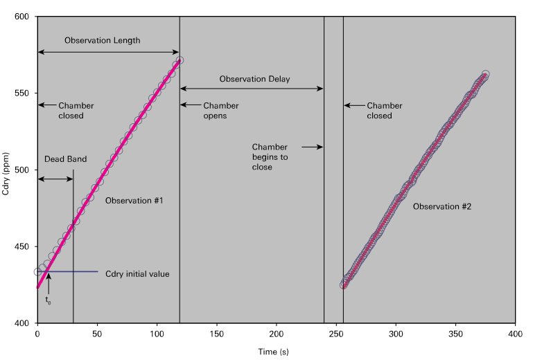

**[B41Q-2298](https://studio.m-anage.com/agu/agu26/meetingapp.cgi/Paper/2070678) Assessing Soil GHG Measurement Protocols for Robustness, Efficiency, and Bias**

**Abstract:** The soil-to-atmosphere flow of CO2 generated by microbes and plant roots is a crucial component of ecosystem carbon cycling, and together with the exchange of methane (CH4) provides top-of-column information about belowground conditions of consequence for atmospheric greenhouse gas (GHG) concentrations. Protocols for measuring these important GHG fluxes need to be consistent but also periodically reassessed for robustness, efficiency, and bias. We use over five years of regular GHG measurements, made at the ecosystem-scale TEMPEST experiment at the Smithsonian Environmental Research Center near Edgewater, MD, USA, for this purpose. The high volume of data (n = 13,000+ flux estimates based on ~750,000 GHG concentration measurements) allow us to examine the impact of methodological choices such as dead band time, measurement length, number of repetitions, number of collars, and the model used to calculate flux, as well as the lifetime of in-ground root exclusion plots. The resulting analyses are useful for assessing flux uncertainty and the impact of different protocols when measuring these important climate-changing trace gases in temperate deciduous forests.

::: {.callout-note}
Look for summary conclusions in 'callouts' like this.
:::

```{r setup}
#| output: false

library(lubridate)
library(tidyr)
library(fluxfinder)
options(fluxfinder.quiet = TRUE)
library(dplyr)
library(broom)
library(ggplot2)
set_theme(theme_bw(base_size = 16))
library(readr)

dbs <- c(0, 5, 10, 15, 20, 25, 30)
mls <- c(30, 35, 40, 45, 50, 55, 60)
```

# Methods

* We use GHG concentrations and computed fluxes measured using a LI7810 and accompanying Smart Chamber between April 2020 and June 2026
* Recalculate fluxes using varying dead band (`r paste(range(dbs), collapse = "-")`s) and measurement length (`r paste(range(mls), collapse = "-")`s) settings
* Test at what point concentration data get more nonlinear
* Test whether doing two reps is worth it




## Data prep

```{r rs2026-data-prep}
DATAFILE_2026 <- "dat2026.RDS"
if(file.exists(DATAFILE_2026)) {
  message("Reading cached ", DATAFILE_2026)
  dat2026 <- readRDS(DATAFILE_2026)
} else {
  # Find the 2026 TEMPEST data files
  files <- list.files(pattern = "json$", 
                      path = "data/",
                      full.names = TRUE) 
  message("Found ", length(files), " data files")
  
  dat_list <- list()
  for(f in files) {
    #message("\tReading ", f)
    ffi_read_LIsmartchamber(f, concentrations = TRUE) |> 
      as_tibble() |> 
      select(Collar = label, RepNum, TIMESTAMP, 
             co2, ch4, DeadBand,
             soilp_c, soilp_m, soilp_t,
             co2_F_o, ch4_F_o) |> 
      mutate(Collar = as.integer(Collar)) ->
      dat_list[[f]]
  }
  # Join everything together
  dat2026 <- bind_rows(dat_list)
  message("Saving ", DATAFILE_2026)
  saveRDS(dat2026, DATAFILE_2026)
}

message("Read ", nrow(dat2026), " 2026 rows")
```

```{r rs202024-data-prep}
DATAFILE_202024 <- "dat202024.RDS"
if(file.exists(DATAFILE_202024)) {
  message("Reading cached ", DATAFILE_202024)
  dat202024 <- readRDS(DATAFILE_202024)
} else {
  conc_files <- list.files("data/ess-dive/concentrations/", pattern = "csv$", full.names = TRUE)
  dat_list <- list()
  for(f in conc_files) {
    read_csv(f, show_col_types = FALSE, guess_max = Inf) |> 
      select(Collar = label, RepNum, TIMESTAMP, 
             co2, ch4, DeadBand,
             soilp_c, soilp_m, soilp_t,
             co2_F_o, ch4_F_o) |> 
      mutate(Collar = as.integer(Collar)) ->
      dat_list[[f]]
  }
  
  # Join everything together
  dat202024 <- bind_rows(dat_list)
  message("Saving ", DATAFILE_202024)
  saveRDS(dat202024, DATAFILE_202024)
}

message("Read ", nrow(dat202024), " 2020-2024 rows")

dat202024 |> 
  bind_rows(dat2026) ->
  dat
rm(dat202024, dat2026)
message("Total: ", nrow(dat), " 2020-2026 rows")
```

Metadata:

```{r metadata}
# Groups
dat$Group <- dat |> 
  group_by(year(TIMESTAMP), yday(TIMESTAMP), Collar, RepNum, co2_F_o) |> 
  group_indices()

n_fluxes <- length(unique(dat$Group))
message("Individual flux measurements (groups): ", n_fluxes)

# Metadata
METADATA_FILE <- "metadata/mapping.csv"
message("Reading ", METADATA_FILE)
md <- read_csv(METADATA_FILE, col_types = "icc")
dat |> 
  left_join(md, by = "Collar") |> 
  # compute elapsed time
  group_by(Group) |> 
  mutate(time_s = as.numeric(TIMESTAMP - min(TIMESTAMP))) |> 
  ungroup() ->
  dat
```

```{r qaqc}
# There are some bizarrely long (in terms of time) groups
# Not sure what's going on with that! Drop 'em
dat |>
  group_by(Group) |> 
  summarise(max_time_s = max(time_s)) ->
  time_smry
message(sum(time_smry$max_time_s > 119), " of ", n_fluxes,
        " groups are over 119 s; removing")

dat |> 
  group_by(Group) |> 
  filter_out(max(time_s) > 119) |> 
  ungroup() -> 
  dat
```

# Results

Soil GHG concentration observations: `r nrow(dat)`

```{r db-ml-analysis}
# We cache the results, as this is slow (several hours on my laptop)
# Remove the saved file to force recalculation
RESULTS_FILE <- "results.RDS"
 if(file.exists(RESULTS_FILE)) {
   warning("Reading ", RESULTS_FILE)
   results <- readRDS(RESULTS_FILE)
 } else {
   # For each group, calculate how R2 and other metrics change as 
   # dead band and measurement length vary
   results <- list()
   grouplist <- sort(unique(dat$Group))
   pb <- utils::txtProgressBar(min = 1, max = length(grouplist), style = 3)
   for(g in seq_along(grouplist)) {
     setTxtProgressBar(pb, g)
     grp <- grouplist[g]
     # Isolate group data
     dat_g <- filter(dat, Group == grp)
     if(nrow(dat_g) == 0) next
    
     for(db in dbs) { # dead band loop
       for(ml in mls) { # measurement length loop
         dat_g |> 
           # Drop data in the dead band...
           filter(time_s > db) |> 
           # ...and drop data beyond the measurement length
           slice_head(n = ml) ->
           this_dat
         if(nrow(this_dat) < 10) next
         
         # There are a few flux calculations that error inside of 
         # fluxfinder, so wrap this part in try()
         try({
           suppressWarnings({
             co2_results <- fluxfinder::ffi_fit_models(this_dat$time_s, this_dat$co2)
             co2_results$Gas <- "CO2"
             ch4_results <- fluxfinder::ffi_fit_models(this_dat$time_s, this_dat$ch4)
             ch4_results$Gas <- "CH4"
           })
           # save the results and move on
           bind_rows(co2_results, ch4_results) |> 
           bind_cols(tibble(Collar = this_dat$Collar[1],
                            grp = grp, db = db, ml = ml, 
                            n = nrow(this_dat))) ->
           results[[paste(grp, db, ml)]]
         }) # try

       } # for ml
     } # for db
   } # for g
   
   results <- bind_rows(results) |> as_tibble()
   message("Saving ", RESULTS_FILE)
   saveRDS(results, file = RESULTS_FILE)   
 }

results |> 
  filter(db == min(db), ml == max(ml)) ->
  fluxes_all_obs
```

## Overall visualization

```{r}
#| fig-width: 8
#| label: fig-r2-hist
 
fluxes_all_obs |> 
  ggplot(aes(x = lin_r.squared)) + 
  geom_histogram(bins = 30) + 
  facet_wrap(~Gas) + 
  ggtitle("Overall lin_r.squared distribution, all data")

message("CH4 quantiles for linear R2:")
qch4 <- quantile(fluxes_all_obs$lin_r.squared[fluxes_all_obs$Gas == "CH4"]) |> 
  round(digits = 2)
print(qch4)
message("CO2 quantiles for linear R2:")
qco2 <- quantile(fluxes_all_obs$lin_r.squared[fluxes_all_obs$Gas == "CO2"]) |> 
  round(digits = 2)
print(qco2)
```

::: {.callout-note title="Conclusion"}
Computed CO2 fluxes had very high linear-model R2 overall; less so for CH4, but even there 50% of fluxes had R2 > `r qch4["50%"]`.
:::

```{r}
#| label: tbl-quantiles

# At this point we filter data to the {1%, 99%} quantile
qnt <- c(0.005, .995)
fluxes_all_obs |> 
  group_by(Gas) |> 
  reframe(quant = quantile(lin_flux.estimate, qnt)) |>
  mutate(which = rep(c("q1", "q2"), length(unique(Gas)))) |>
  pivot_wider(names_from = "which", values_from = "quant") -> 
  flux_quantiles
qnt_string <- paste0("(", qnt[1], ", ", qnt[2], ")")
message("Limiting data to ", qnt_string, " quantiles")
knitr::kable(flux_quantiles, 
             col.names = c("Gas", qnt),
             digits = 3,
             caption = "99% quantiles of CH4 and CO2 fluxes")
```

```{r}
#| fig-width: 8
#| label: fig-flux-hist

fluxes_all_obs |> 
  left_join(flux_quantiles, by = "Gas") |> 
  filter(lin_flux.estimate >= q1, 
         lin_flux.estimate <= q2) ->
  fluxes_filtered

results |> 
  left_join(flux_quantiles, by = "Gas") |> 
  filter(lin_flux.estimate >= q1, 
         lin_flux.estimate <= q2) ->
  results_filtered

fluxes_filtered |> 
  ggplot(aes(x = lin_flux.estimate)) + 
  geom_histogram(bins = 30) + 
  facet_wrap(~Gas, scales = "free") + 
  ggtitle(paste0("Overall lin_flux.estimate ", qnt_string))
```

## Nonlinearity

```{r}
#| label: tbl-nonlinear-ml

results |> 
  filter(db == min(db)) |> 
  mutate(nonlinear = !is.na(HM81_flux.estimate)) |> 
  group_by(Gas, ml) |> 
  summarise(nonlinear_pct = sum(nonlinear) / n(), .groups = "drop") |>
  pivot_wider(names_from = "Gas", 
              values_from = "nonlinear_pct") |> 
  knitr::kable(col.names = c("Measurement length (s)", "CH4", "CO2"),
               digits = 3,
               caption = "Fraction of fluxes with 'nonlinear' fluxfinder flag, by measurement length")
```

::: {.callout-note title="Conclusion"}
(Potential) nonlinearity of fluxes climbs rapidly with measurement length.
:::

```{r}
#| fig-width: 8
#| label: fig-nonlinear-flux-comparison

fluxes_filtered |> 
  ggplot(aes(lin_flux.estimate, HM81_flux.estimate)) +
  geom_point(aes(color = lin_r.squared), alpha = 0.5, size = 0.5, na.rm = TRUE) + 
  facet_wrap(~Gas, scales = "free") + 
  geom_abline() +
  theme(legend.position = "bottom", legend.text = element_text(angle = 90)) +
  geom_smooth(method = lm, formula = 'y ~ x',
              linetype = 2, color = "black", na.rm = TRUE) +
  ggtitle(paste("Nonlinear fluxes", qnt_string))
```

```{r}
#| fig-width: 8
#| label: fig-nonlinear-r2-comparison

fluxes_filtered |> 
  ggplot(aes(lin_r.squared, HM81_r.squared)) +
  geom_point(size = 0.5, alpha = 0.5, na.rm = TRUE) + 
  facet_wrap(~Gas, scales = "free") + 
  geom_abline() +
  theme(legend.position = "bottom", legend.text = element_text(angle = 90)) +
  geom_smooth(method = lm, formula = 'y ~ x',
              linetype = 2, color = "black", na.rm = TRUE) +
  ggtitle(paste("Nonlinear R2s", qnt_string))
```


::: {.callout-note title="Conclusion"}
Failing to account for nonlinearity tends to underestimate the CO2 flux.
:::

## Deadband effect

```{r}
#| label: tbl-db-r2

# Does dead band affect the R2 of the linear flux?

# For each dead band level we only want the max measurement length
results_filtered |> 
  group_by(Gas, db) |> 
  filter(ml == max(ml)) ->
  db_results

# How many groups have increasing, decreasing, no trend?]
db_results |> 
  group_by(Gas, grp) |> 
  reframe(broom::tidy(lm(lin_r.squared ~ db))) |>
  filter(term == "db") |> 
  mutate(Trend = factor(if_else(p.value >= 0.05, "None", 
                         if_else(estimate < 0, "Negative", "Positive")))) ->
  db_trends

db_trends |> 
  group_by(Gas, Trend) |> 
  summarise(N = n(), .groups = "drop_last") |> 
  mutate(Fraction = N / sum(N)) |> 
  knitr::kable(digits = 3,
               caption = "Linear R2 trends with increasing dead band")
```

```{r}
#| fig-width: 8
#| label: fig-db-r2

VIZ_SUBSAMPLE <- 1000

db_results |> 
  group_by(Gas, db) |> 
  summarise(lin_r.squared = mean(lin_r.squared), .groups = "drop") ->
  db_results_mean

db_results |> 
  slice_sample(n = VIZ_SUBSAMPLE) |> 
  left_join(db_trends, by = c("Gas", "grp")) |> 
  filter(!is.na(Trend)) |> 
  ggplot(aes(db, lin_r.squared)) +
  geom_line(aes(group = grp, color = Trend), alpha = 0.1) + 
  geom_line(data = db_results_mean, color = "blue", linewidth = 1) +
  facet_wrap(~Gas) +
  guides(colour = guide_legend(override.aes = list(alpha = 1))) +
  coord_cartesian(ylim = c(0.5, 1.0)) +
  ggtitle(paste0("Dead band versus R2, ml=", max(mls)),
          subtitle = paste("Random", VIZ_SUBSAMPLE, "subsample")) +
  xlab("Dead band (s)")
```

::: {.callout-note title="Conclusion"}
Using a dead band of 5s produces a small gain in the fitted flux, but after that only declines as we lose data.
:::

## Measurement length effect

```{r}
#| label: tbl-ml-r2

# Does measurement length affect the R2 of the linear flux?

# For each measurement length level we only want the min dead band
results_filtered |> 
  group_by(Gas, ml) |> 
  filter(db == min(db)) ->
  ml_results

# How many groups have increasing, decreasing, no trend?
suppressWarnings({
  ml_results |> 
    group_by(Gas, grp) |> 
    reframe(broom::tidy(lm(lin_r.squared ~ ml))) |>
    filter(term == "ml") |> 
    mutate(Trend = factor(if_else(p.value >= 0.05, "None", 
                                  if_else(estimate < 0, "Negative", "Positive")))) ->
    ml_trends
})

ml_trends |> 
  group_by(Gas, Trend) |> 
  summarise(N = n(), .groups = "drop_last") |> 
  mutate(Fraction = N / sum(N)) |> 
  knitr::kable(digits = 3,
               caption = "Linear R2 trends with increasing measurement length")
```


```{r}
#| fig-width: 8
#| label: fig-ml-r2

ml_results |> 
  group_by(Gas, ml) |> 
  summarise(lin_r.squared = mean(lin_r.squared), .groups = "drop") ->
  ml_results_mean

ml_results |> 
  slice_sample(n = VIZ_SUBSAMPLE) |> 
  left_join(ml_trends, by = c("Gas", "grp")) |> 
  filter(!is.na(Trend)) |> 
  ggplot(aes(ml, lin_r.squared)) +
  geom_line(aes(group = grp, color = Trend), alpha = 0.1) + 
  geom_line(data = ml_results_mean, color = "blue", linewidth = 1) +
  facet_wrap(~Gas) + 
  guides(colour = guide_legend(override.aes = list(alpha = 1))) +
  coord_cartesian(ylim = c(0.5, 1.0)) +
  ggtitle("Measurement length versus R2, db=0",
          subtitle = paste("Random", VIZ_SUBSAMPLE, "subsample")) +
  xlab("Measurement length (s)")
```
::: {.callout-note title="Conclusion"}
At least out to 60s, longer measurements means better model fits.
:::

## Detailed by-collar look

```{r by-collar-look}
#| fig-width: 10
#| fig-height: 8

# Plot how R2 values with changing dead band and measurement length 
# (i.e., the dm-ml-analysis above) for each collar.
# We plot the two gases separately; connect point by group number
# to see the effect of the changing variable; and color by overall
# trend for that collar.

# Helper function
trends <- function(p.values, estimates) {
  x <- if_else(p.values > 0.05, "None", 
          if_else(estimates < 0, "Negative", "Positive"))
  factor(x, levels = c("None", "Positive", "Negative"))
}

for(gas in unique(results$Gas)) {
  # Dead band
  # Isolate the data for this gas and full measurement length
  dat_gas_db <- results |> filter(Gas == gas, ml == max(mls))
  # ...and calculate overall trend: positive, negative, or none
  dat_gas_db |> 
    group_by(Collar) |> 
    reframe(broom::tidy(lm(lin_r.squared ~ db))) |> 
    filter(term == "db") |>
    transmute(Collar = Collar, 
              Trend = trends(p.value, estimate)) ->
    db_trends
  # Finaly calculate whether it's curvilinear
  # (increasing then decreasing)
  # TODO
  
  # Plot and summary table
  p1 <- ggplot(dat_gas_db |> left_join(db_trends, by = "Collar"),
         aes(db, lin_r.squared, color = Trend, group = grp)) +
    geom_line(linewidth = 0.1, alpha = 0.5) +
    facet_wrap(~Collar) + 
    theme(strip.text = element_text(size = 6)) +
    ggtitle(paste0(gas, " dead band effect by collar, ml=", max(mls))) +
    scale_color_manual("Overall\ntrend", drop = FALSE, 
                       values = c("black", "darkgreen", "darkred")) +
    xlab("Dead band (s)")
  print(p1)
  
  db_trends |> 
    group_by(Trend) |> 
    summarise(N = n()) |> 
    print()
  
  # Measurement length
  # Isolate the data for this gas and dead band of zero
  dat_gas_ml <- results |> filter(Gas == gas, db == min(dbs))
  # ...and calculate overall trend: positive, negative, or none
  dat_gas_ml |> 
    group_by(Collar) |> 
    reframe(broom::tidy(lm(lin_r.squared ~ ml))) |> 
    filter(term == "ml") |>
    transmute(Collar = Collar, 
              Trend = trends(p.value, estimate)) ->
    ml_trends
  
  # Plot and summary table
  p2 <- ggplot(dat_gas_ml |> left_join(ml_trends, by = "Collar"),
         aes(ml, lin_r.squared, color = Trend, group = grp)) +
    geom_line(linewidth = 0.1, alpha = 0.5) +
    facet_wrap(~Collar) + 
    theme(strip.text = element_text(size = 6)) +
    ggtitle(paste0(gas, " measurement length effect by collar, db=", min(dbs))) +
    scale_color_manual("Overall\ntrend", drop = FALSE,
                       values = c("black", "darkgreen", "darkred")) +
    xlab("Measurement length (s)")
  print(p2)
  
  db_trends |> 
    group_by(Trend) |> 
    summarise(N = n()) |> 
    print()
}

```

## Repetitions

If we had stopped after one repetition, would we have gotten the same flux?

```{r}
#| fig-width: 8
#| label: fig-reps-co2

# Use the Smart Chamber fluxes for this
dat |> 
  # some SC fluxes can be 0.0
  filter(co2_F_o != 0.0, 
         # and we don't want crazy values
         co2_F_o > flux_quantiles$q1[2], co2_F_o < flux_quantiles$q2[2]) |> 
  filter(ch4_F_o != 0.0, 
         ch4_F_o > flux_quantiles$q1[1], ch4_F_o < flux_quantiles$q2[1]) |> 
  group_by(Group, RepNum, Collar) |> 
  summarise(co2_F_o = mean(co2_F_o),
            ch4_F_o = mean(ch4_F_o), 
            .groups = "drop") ->
  dat_fluxes

dat_fluxes |> 
  filter(RepNum == 1) |> 
  rename(co2_F_o_R1 = co2_F_o, ch4_F_o_R1 = ch4_F_o) |> 
  select(-RepNum) ->
  dat_fluxes_R1

dat_fluxes |> 
  # overwrite Group numbers to be 1, 1, 3, 3, 5, 5, etc., rather than 1, 2, 3, 4...
  mutate(Group = floor((Group - 1) / 2) * 2 + 1) |> 
  group_by(Group, Collar) |> 
  summarise(co2_F_o = mean(co2_F_o), 
            ch4_F_o = mean(ch4_F_o), .groups = "drop") |> 
  left_join(dat_fluxes_R1, by = c("Group", "Collar")) ->
  dat_fluxes_reptest

ggplot(dat_fluxes_reptest, aes(co2_F_o, co2_F_o_R1)) + 
  geom_point(na.rm = TRUE) + 
  geom_abline() + 
  geom_smooth(method = lm, na.rm = TRUE, formula = y ~ x) + 
  ggtitle("CO2 two-rep average versus first rep only")

message("t-test (N = ", nrow(dat_fluxes_reptest), "):")
t.test(dat_fluxes_reptest$co2_F_o_R1, dat_fluxes_reptest$co2_F_o, paired = TRUE)
```

```{r}
#| fig-width: 8
#| label: fig-reps-ch4

dat_fluxes_reptest |> 
  mutate(fluxsign = if_else(ch4_F_o > 0, "Positive", "Negative fluxes")) ->
  dat_fluxes_reptest

ggplot(dat_fluxes_reptest, aes(ch4_F_o, ch4_F_o_R1)) + 
  geom_point(na.rm = TRUE) + 
  geom_abline() + 
  geom_smooth(method = lm, na.rm = TRUE, formula = y ~ x) + 
  ggtitle("CH4 two-rep average versus first rep only") +
  facet_grid(. ~ fluxsign, scales = "free", space = "free_x")

ch4_negative <- dat_fluxes_reptest |> filter(ch4_F_o < 0)
message("t-test (negative fluxes, N = ", nrow(ch4_negative), "):")
t.test(ch4_negative$ch4_F_o_R1, ch4_negative$ch4_F_o, paired = TRUE)
ch4_positive <- dat_fluxes_reptest |> filter(ch4_F_o >= 0)
message("t-test (positive fluxes, N = ", nrow(ch4_positive), "):")
t.test(ch4_positive$ch4_F_o_R1, ch4_positive$ch4_F_o, paired = TRUE)
```

::: {.callout-note title="Conclusion"}
No difference overall between first-rep-only fluxes and two-rep means.
:::

# POSTER

* Photo of Mia measuring at TEMPEST
* Start with @fig-flux-hist AND/OR add a plot over time?
* Nonlinearity: @tbl-nonlinear-ml and @fig-nonlinear-flux-comparison and @fig-nonlinear-r2-comparison
* Dead band: @fig-db-r2
* Measurement length: @fig-ml-r2
* Reps: @fig-reps-ch4 and @fig-reps-co2 (with inset t-test results)

Right now this doesn't look at any treatment or abiotic effects -- e.g., whether nonlinearity varies with time

Need to fix flux calculations
